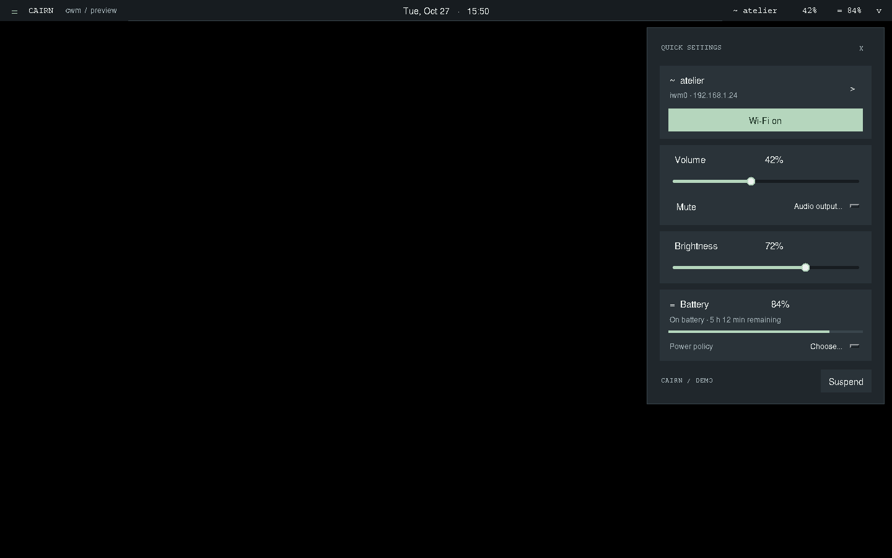

# Cairn

**A quiet panel for OpenBSD cwm.**

cwm의 간결한 상단바에 GNOME 스타일의 빠른 설정을 더한 X11 패널입니다.
짙은 청회색, 옅은 녹색 강조, 얇은 테두리와 작은 카드로 구성했습니다.
Python/Tk UI와 외부 크레이트가 없는 작은 Rust 데몬으로 나뉩니다.



## 구현된 기능

- 날짜·시간, 월별 달력, 오늘로 이동
- 유선·무선 상태와 IP 주소, Wi-Fi 켜기/끄기, 검색, WPA-PSK/오픈 네트워크 임시 접속
- 배터리 잔량, AC 연결, 예상 사용 시간
- 전원 정책: 자동(`apm -A`), 저전력(`apm -L`), 최대 성능(`apm -H`), 절전 확인
- sndio 출력 볼륨·음소거, 설정된 sndiod 장치 전환
- 화면 밝기 슬라이더
- 비동기 장치 제어, 오류 표시, 실장치 없이 실행하는 데모 모드

현재 초기 구현입니다. Linux Xvfb에서 UI와 프로토콜을 검증했으며,
OpenBSD 실기기의 드라이버·권한·sndiod 설정에 대한 검증은 남아 있습니다.

## 구조

```text
Python/Tk panel (일반 사용자)
  ├─ ifconfig -a / apm              상태 조회
  ├─ sndioctl                       사용자 오디오 세션
  └─ Unix socket                   /var/run/cairn/control.sock
        └─ cairnd (Rust, root)
             ├─ ifconfig           Wi-Fi 검색·접속·인터페이스 up/down
             ├─ wsconsctl          밝기 조회·설정
             └─ apm / zzz          전원 정책·절전
```

셸 명령 문자열을 실행하지 않고 고정된 실행 파일에 검증한 인자만 전달합니다.
데몬은 직렬 요청 처리, 입력 크기 제한, 소켓 및 명령 시간 제한을 사용합니다.
네트워크 매니저 전체를 구현하기보다 OpenBSD 기본 도구를 좁게 감싸는 구조입니다.

## 데모

Python 3.10 이상과 Tk가 필요합니다. Python 패키지 의존성은 없습니다.

```sh
python3 -m cwm_panel --demo --open settings
python3 -m cwm_panel --demo --open calendar
```

시계 클릭은 달력, 오른쪽 상태 영역 클릭은 빠른 설정입니다.
`Esc` 또는 바깥 클릭으로 패널을 닫습니다. 슬라이더는 방향키와 Home/End도 지원합니다.
상태 영역 우클릭으로 진단과 종료 메뉴를 열 수 있습니다.

## OpenBSD 설치

### 1. 도구 및 사용자 패널

패키지의 Python 버전과 맞는 `python` / `python-tkinter` flavor를 선택합니다.
`pkg_add`가 버전 선택을 요청할 수 있습니다. 아래의 `python3`는 설치된 실제
인터프리터 이름(예: `python3.12`)으로 바꿔 사용합니다.

```sh
doas pkg_add python python-tkinter rust
python3 -m venv --system-site-packages ~/.local/share/cairn/venv
~/.local/share/cairn/venv/bin/python -m pip install .
mkdir -p ~/.local/bin
ln -s ~/.local/share/cairn/venv/bin/cairn ~/.local/bin/cairn
```

`ifconfig`, `apm`, `wsconsctl`, `sndioctl`, `zzz`는 OpenBSD 기본 시스템 도구입니다.
Python/Tk는 X11 디스플레이에서 실행해야 합니다. 패널을 root로 실행하지 않습니다.

### 2. 작은 권한 데몬

```sh
cd daemon
cargo build --release
cd ..
doas groupadd cairn
doas usermod -G cairn "$USER"
doas install -o root -g bin -m 0555 daemon/target/release/cairnd /usr/local/sbin/cairnd
doas install -o root -g wheel -m 0555 examples/cairnd.rc /etc/rc.d/cairnd
doas rcctl enable cairnd
doas rcctl start cairnd
```

기존 `cairn` 그룹이 있다면 `groupadd`는 생략합니다. 그룹 추가 후 새 로그인 세션에서
실행합니다. rc.d 스크립트가 `/var/run/cairn`을 root:cairn, `2750`으로 생성하고,
데몬이 그룹 접근 전용 소켓(`0660`)을 만듭니다. 별도 doas 규칙은 필요 없습니다.

`cairn` 그룹에 속한 사용자는 Wi-Fi 설정, 밝기, 전원 정책과 절전을 제어할 수 있습니다.
이 그룹은 해당 제어 권한을 줄 사용자에게만 부여합니다. 데몬은 root로 실행되며,
아직 OpenBSD `pledge`/`unveil` 제한을 적용하지 않았습니다.

### 3. cwm 시작과 화면 영역

[examples/cwmrc](examples/cwmrc)의 `gap 34 0 0 0`을 `~/.cwmrc`에 합칩니다.
패널 높이를 바꾸면 gap도 맞춥니다. 화면 예약은 cwm의 gap 설정으로 처리합니다.

`~/.xsession`에서 cwm 실행 앞에 패널을 시작합니다.

```sh
$HOME/.local/bin/cairn &
exec cwm
```

기존 `.xsession`의 환경 설정은 유지합니다. 실행 파일 이름은 `cairn`, 데몬은 `cairnd`입니다.

## 설정

`examples/config.json`을 `~/.config/cairn/config.json`으로 복사합니다.
`--config /absolute/path/config.json` 또는 `XDG_CONFIG_HOME`으로 경로를 바꿀 수 있습니다.

```json
{
  "height": 34,
  "margin": 12,
  "poll_seconds": 5,
  "socket": "/var/run/cairn/control.sock",
  "audio_devices": [
    {"name": "Built-in audio", "value": "0"},
    {"name": "USB DAC", "value": "1"}
  ]
}
```

장치 목록은 자동 탐색 목록이 아니라 사용자의 sndiod 설정에 대응하는 선택지입니다.
여러 장치 사이에서 전환하려면 sndiod의 `-f` / `-F` 대체 장치 구성을 준비하고,
`sndioctl server.device`가 제공하는 선택 값과 `audio_devices[].value`를 맞춥니다.
지원하지 않는 시스템에서는 전환 요청의 오류가 패널에 표시됩니다.
HDMI·USB·내장 장치를 다른 sndiod 인스턴스에서 쓰는 구성이나 Bluetooth 장치
페어링, 입력 장치·마이크 제어는 현재 지원하지 않습니다.

## 네트워크와 전원 범위

Wi-Fi 접속은 현재 세션의 `ifconfig` 설정에만 적용하고, `inet autoconf`를 통해
`dhcpleased`의 주소 설정을 요청합니다. 정상적인 DHCP 접속에는 `dhcpleased`가
동작해야 합니다. 서비스는 주소 취득 완료를 기다리지 않으며 다음 상태 조회에서
IP가 표시됩니다. `/etc/hostname.if`를 수정하거나 저장된 join 프로필을 관리하지 않습니다.
다음 부팅에도 유지할 연결은 OpenBSD의 `hostname.if(5)`로 별도 설정합니다.

WPA-Enterprise/802.1X, captive portal 로그인, 정적 IP·DNS 편집, VPN 관리,
WEP와 숨겨진 SSID 수동 입력은 범위 밖입니다. 비밀번호는 패널/데몬의 메모리와
로컬 요청에 잠시 존재하고 파일·로그에 저장하지 않습니다. 시스템 `ifconfig`를 호출하는
동안 키가 프로세스 인자로 전달되므로 같은 시스템의 프로세스 조회 권한에 주의해야 합니다.
Hex 인코딩은 프레이밍 용도이며 암호화가 아닙니다.

전원 정책은 OpenBSD의 apm 인터페이스에 해당합니다. GNOME의 Linux power-profiles-daemon과
동일한 정책을 제공하는 것은 아닙니다. 배터리 충전 상한은 구현하지 않았습니다.
밝기와 잔여 시간은 하드웨어 지원 여부에 따라 사용할 수 없을 수 있습니다.
다중 모니터별 패널·밝기 조절은 아직 지원하지 않으며 기본 X11 화면 상단에 표시합니다.

## 개발과 검증

```sh
python3 -m unittest discover -s tests -v
cd daemon && cargo test && cargo clippy --all-targets -- -D warnings
```

X11 상호작용 테스트까지 실행하려면 DISPLAY가 있는 환경에서 테스트를 실행하거나:

```sh
xvfb-run -a python3 -m unittest discover -s tests -v
```

Tk 창 생성·새로고침이 하드웨어 설정을 쓰지 않는지, 슬라이더 요청 병합,
달력 이동, 네트워크 검색, 소켓 오류 및 유니코드 전송, 명령 인자 검증을 확인합니다.
Rust 데몬은 Linux에서도 빌드·단위 테스트가 가능하며 실제 서비스 실행은 OpenBSD로 제한합니다.
[docs/protocol.md](docs/protocol.md)에 데몬 요청 형식이 있습니다.

ISC license.
